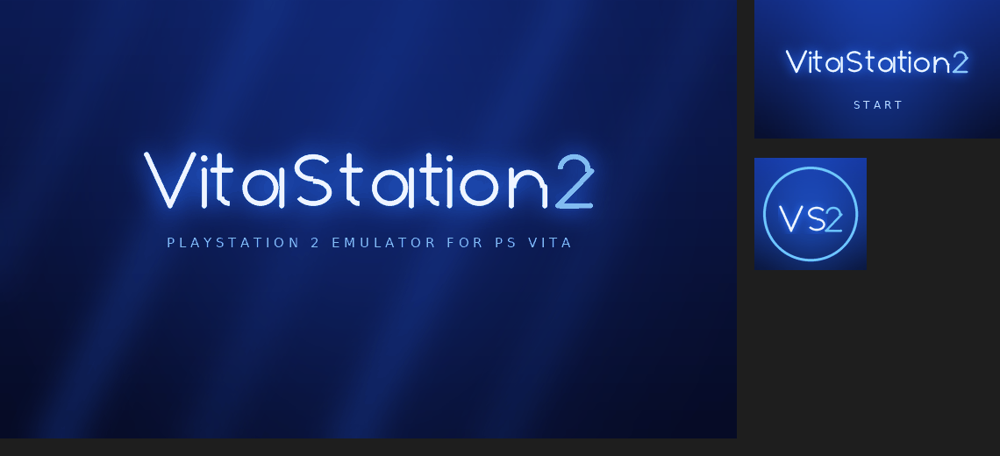
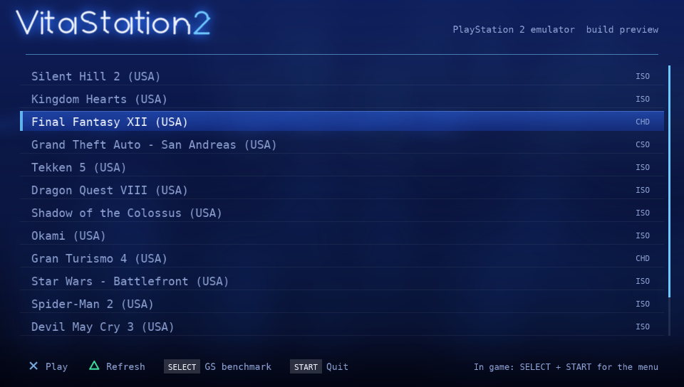

# VitaStation2



An experimental PlayStation 2 emulator for the PlayStation Vita / PS TV
(formerly VitaPS2; the app keeps its title ID and `ux0:data/VitaPS2` data
folder, so it updates in place).



**Which games:** [docs/COMPATIBILITY.md](docs/COMPATIBILITY.md) tracks the
top 50 PS2 games that have no Vita version, with their status in the
emulation core and measurements on a real Vita.

VitaStation2 runs the [Play!](https://github.com/jpd002/Play-) emulation core (EE and
IOP recompilers, VU, SPU2, high-level emulated BIOS, so **no BIOS dump is
needed**) on the Vita through its 32-bit ARM JIT, with new **GPU** and **software**
Graphics Synthesizer renderers and a native vitaGL frontend.

> **Set expectations:** the Vita's Cortex-A9 is roughly 10x slower than what
> full-speed PS2 emulation needs on ARM. Commercial 3D games will run far
> below full speed. See [docs/RESEARCH.md](docs/RESEARCH.md) for the analysis, [docs/ROADMAP.md](docs/ROADMAP.md) for the plan (library-wide first: the top 50 PS2 games without a Vita version) and [docs/AOT_TRANSLATION.md](docs/AOT_TRANSLATION.md) for near-native translation,
> the options considered and the optimization roadmap.

## Real-world performance (PS Vita hardware)

Silent Hill 2 on an actual PS Vita, measured from the emulator's own counters
with [tools/vita_realworld.sh](tools/vita_realworld.sh). Full speed is 60
emulated fps; the title screen shows 30 fps and movies play at 30 pictures per
second. Full history: [docs/perf/vita_realworld.md](docs/perf/vita_realworld.md).


<!-- vita-realworld-start -->
| Build | Title screen fps | Movie: emulated fps | Movie: shown fps | Movie: pictures/s | JIT ms/block | Movie: EE % | VIF % | SPU wait % | GS wait % | VIF1 kQW/s |
|---|---|---|---|---|---|---|---|---|---|---|
| stale rows + PSMT4 pages + native movie (2026-11-04) | 25.0 | 15.9 | 15.2 | 1.0 | 2.34 | 35.0 | 27.0 | - | - | - |
<!-- vita-realworld-end -->

Resident Evil 4 on the same Vita, per build. The orange intro and the attract movies
need 30 new pictures per second, which takes 60 emulated fps: they are at 13. Status,
findings and notes for other sessions: [docs/RE4.md](docs/RE4.md).


| Build | Title screen fps | Movie: emulated fps | Movie: new pictures/s |
|---|---|---|---|
| first run (old build) | 3.3 | 5.9 | 3 |
| movie picture fixed, on-demand JIT cache | 34.8 | 5.9 | 3 |
| native movies (libmpeg 3.0), on-demand input | 34.6 | 15.8 | 9 |
| EE slice 19200, decode ahead | 53.4 | 23.5 | 11 |
| GPU round trips removed | 52.5 | 24.5 | 12 |
| Critical sections and start code scan native | 55.5 | 26.5 | 13 |

## Performance gap


How many ARM instructions the emulator executes for each PS2 (EE)
instruction, on four endless game-like workloads: integer code (a CRC loop),
FPU math, 128-bit MMI pixel work, and loads/stores of every size. **1.0 would
be one-to-one; lower is better.** CI measures it on every push to the default
branch by running the ARM build (the Vita's recompiler) under qemu and
counting executed instructions exactly, so the numbers are reproducible
([tools/perf_gap.py](tools/perf_gap.py)); every run adds a row to
[docs/perf/history.csv](docs/perf/history.csv) (table view of the chart).

This tracks CPU emulation cost only: it is not a frame rate. The Vita's A9
also has a lower clock and fewer instructions per cycle than the PS2 needs
for its EE, VUs and GS together, and games differ in what they stress.

## How VitaPS2 is optimized for the Vita, and why

A PS2 has three very different processors (the EE CPU with 128-bit MMI, two
vector units, the GS rasterizer) plus the IOP and SPU2. The Vita has three
usable Cortex-A9 cores at 444 MHz and a mobile GPU. Nothing can be brute
forced, so every change here comes from a measurement on the device:
`perf.csv` (written in autostart mode) records ~70 counters per second
(time per emulator section, JIT phases, GPU stages, idle loop triggers per
register and DMA channel, VIF unpack formats, audio waits), and
[tools/vita_realworld.sh](tools/vita_realworld.sh) turns a run on the Vita
into the table and chart above. Changes to the Play! core live in
[patches/](patches/) (one file per change, applied at configure time) so each
one can be measured, reviewed and reverted on its own.

**CPU emulation: a recompiler built for ARMv7 + NEON.** The EE, VUs and IOP
are translated to ARM code at run time. On the Vita that recompiler gained
NEON registers for 128-bit MMI and VU math, VFP registers for the FPU,
interval register allocation, loop register promotion, compare/select
sinking, inlined guest memory access and a VM memory pool from
`sceKernelAllocMemBlockForVM`. The CI measures the result exactly, as ARM
instructions per PS2 instruction (chart below): since the first measurement,
FPU code went from 15.5 to 7.9 and loads/stores from 19.8 to 7.8. Compile
time matters as much as code quality for scene changes: Jitter symbols use
non-atomic reference counts (each block compile made tens of thousands of
atomic updates, ~40 cycles each on the A9).

**Three cores, each with one job.** The EE thread runs on core 0, the GS
(GPU) and frontend on core 1, VU1, SPU2 mixing and the movie decoder on
core 2. Moving SPU2 mixing to its own core cut the EE's audio waits from 27%
of its time to 0.1%.

**A GPU GS renderer that avoids round trips.** GS frame buffers stay in GPU
render targets; GS memory is synchronized only when the CPU side needs it,
row by row. Menus that write textures into frame buffer memory every frame
were the worst case: those writes now go a row run at a time (2.3x faster),
unchanged data is skipped, and uploads into a render target that the next
opaque full-screen draw replaces are skipped entirely.

**Idle loops cost nothing.** Games poll hardware registers in tight loops.
The EE detects those loops per register and DMA channel and skips ahead;
during movies this took the IPU from 45,000 wasted poll loops per second to
none.

**Data paths without per-element overhead.** VIF unpacks (geometry for VU1)
have fast loops per format and masked lanes (VIF time during the movie: 30% ->
12%); the texture cache decodes whole spans per format and hashes page
contents; a lock-protected arena allocator replaces malloc for the core's
many small objects.

**Movies decoded natively (experimental, `mpeg_hle=1`).** Emulating Sony's
MPEG library costs ~1.3 ms of Vita CPU per macroblock, under 1 picture per
second. VitaPS2 can replace `sceMpegGetPicture` with its own MPEG-2 decoder
on core 2 (word-wise bit reader, 11-bit VLC tables, NEON prediction; 2.2x
faster than its first version, bit-identical output) fed straight from the
game's DMA stream.

**Save states** (SELECT + R to save, SELECT + Triangle to load) make each
scene repeatable, so a change can be measured on the exact same frames.

## Status

| Component | State |
|---|---|
| EE / IOP / VU / SPU2 / HLE BIOS | Play! core with ~60 performance and Vita patches ([patches/](patches/)) |
| JIT on Vita (`sceKernelAllocMemBlockForVM` pool) | Running on hardware |
| GPU GS renderer (vitaGL, default) | Running on hardware; tested against the software renderer on the host |
| Software GS renderer (accuracy fallback) | Implemented and unit tested (see below) |
| Vita frontend (game list, display, controls, audio, save states) | Running on hardware |
| Silent Hill 2 (SLUS-20228) | Boots through the menus and plays the opening movie (below full speed) |
| Resident Evil 4 (SLUS-21134) | Reaches the title menu and plays its movies with native decoding (13 of 30 pictures/s); gameplay not reached yet |
| Host build + automated tests | Passing |
| VPK build | CI with the official VitaSDK Docker image |

## Installing on a Vita

1. Requires HENkaku/Ensō with **Unsafe Homebrew enabled** (HENkaku Settings):
   the recompiler needs executable memory.
2. Requires the runtime shader compiler `ur0:data/libshacccg.suprx` (used by
   vitaGL; many Vita ports need it). Extract it once with
   [ShaRKBR33D](https://github.com/Rinnegatamante/ShaRKBR33D). VitaPS2 shows an
   explanation screen if it is missing.
3. Install `VitaPS2.vpk` (from the CI artifacts) with VitaShell.
4. Copy games (`.iso`, `.cso`, `.chd`, `.isz`, `.cue`, `.mds`, `.bin`) or
   homebrew (`.elf`) to `ux0:data/VitaPS2/games/`.

### Controls

| Vita | PS2 |
|---|---|
| D-pad, face buttons, sticks, START, SELECT | same |
| L / R | L1 / R1 |
| Rear touch left / right half | L2 / R2 |
| Front touch bottom-left / bottom-right corner | L3 / R3 |
| SELECT + START | pause menu: renderer, speed hacks, aspect, overlay, quit |
| SELECT + L | toggle performance overlay |
| SELECT + R / SELECT + Triangle | save state / load state (one per game, `ux0:data/VitaPS2/states/`) |

Settings chosen in the pause menu are saved per game in
`ux0:data/VitaPS2/settings/`.

On PS TV, a DualShock 3/4's L2/R2/L3/R3 work directly.

## Performance work

### GPU renderer (default)

Measured on hardware, the A9 can rasterize only 1-5 Mpix/s of textured,
blended PS2 primitives in software, far below what 3D games draw. The GPU
renderer (`src/gs/hw/`) translates GS primitives into fixed-function OpenGL
draws (vitaGL on the Vita):

* GS framebuffers live in GPU render targets; GS memory is synchronized only
  when the CPU side needs it (transfers, CLUT loads, textures of a different
  layout), so typical frames never leave the GPU.
* Textures are decoded with the software renderer's texture cache and cached
  as GL textures; render-to-texture effects sample render targets directly.
* GS blending `(A-B)*C+D`, alpha/depth tests, color masks and texture
  functions map onto GL blend equations and the texture combiner (0x80 = 1.0
  handled through combiner scales). Perspective (STQ) uses clip-space
  `w = 1/Q`.
* The GS runs on the main thread (which owns the GL context), freeing a CPU
  core compared to the software renderer.
* Host tests render scenes with both renderers through Mesa and compare them.

### Software renderer (Pause menu -> Renderer)

Built for the Vita's Cortex-A9 (see `gs_benchmark`):

* **Span-based rasterizer**: exact integer scanline extents, fixed-point
  stepping, span loops specialized per state (texture/filter/depth/format/blend).
* **Decoded texture cache**: textures decoded to RGBA once (lazily per 8x8
  tile), invalidated by GS memory page stamps, CLUT hash and TEXA.
* **Multi-threaded GS**: primitives are batched and rasterized by several
  threads that own interleaved scanlines — output is bit-identical to single
  threaded rendering (verified by `gs_parallel_tests`, ThreadSanitizer clean).
* **Speed hacks** (pause menu, per game): EE cycle rate (underclock, or
  *Auto*: stepped down to 60% while the EE is the bottleneck and back up when
  there is headroom), interlaced half-line rendering, frame skip, VU1 on its
  own core.
* **Per-game profiles**: `assets/game_profiles.ini` ships default settings per
  disc serial (e.g. `[SLUS-20228]`); the player's own choices in the pause
  menu override them. The serial is shown in the overlay and the log.

| Workload (host x86, 1 thread → 3 threads) | Mpix/s |
|---|---|
| Clear / flat fill | 64 → ~930 |
| Textured sprite, 8-bit CLUT | 31 → 216 |
| Bilinear + alpha blend | 15 → 64 |
| Gouraud + Z | 21 → 152 |
| Perspective textured + blend + Z (3D) | 11 → 63 |

(left column: first implementation; right: current with 3 threads)

## Building

```sh
git clone --recursive <this repo>
```

### PS Vita

With [VitaSDK](https://vitasdk.org) installed (`$VITASDK` set):

```sh
cmake -S . -B build-vita -DCMAKE_TOOLCHAIN_FILE=$VITASDK/share/vita.toolchain.cmake -DCMAKE_BUILD_TYPE=Release
cmake --build build-vita -j
# -> build-vita/VitaPS2.vpk
```

or with Docker: `docker run --rm -v $PWD:/src -w /src vitasdk/vitasdk:latest sh -c 'cmake -S . -B build-vita -DCMAKE_TOOLCHAIN_FILE=$VITASDK/share/vita.toolchain.cmake && cmake --build build-vita -j'`

### ARM Linux under qemu — the Vita's recompiler on a PC

`cmake/toolchains/armhf-linux.cmake` cross-builds everything for a Cortex-A9
and runs the tests through `qemu-arm`, including Play!'s AArch32 recompiler
(the code path used on the Vita). See the file header for the packages.

### Host (Linux/macOS) — development and tests

The host build uses the exact same core and software GS, headless:

```sh
cmake -S . -B build -G Ninja -DCMAKE_BUILD_TYPE=Release
cmake --build build
ctest --test-dir build --output-on-failure
./build/vitaps2_host game.iso --frames 300 --out frame.ppm
./build/vitaps2_host game.iso --frames 300 --out frame.ppm --hw   # GPU renderer via Mesa
```

Tests:

* `gs_software_tests` — rasterizer and GS pipeline unit tests.
* `jit_pool_tests` — executable memory pool allocator.
* `gs_diff_tests` — optimized rasterizer vs. the simple reference
  implementation on random states and primitives.
* `gs_parallel_tests` — multi-threaded rendering is bit-identical to single
  threaded rendering.
* `gs_benchmark [seconds] [threads]` — renderer throughput.
* `gs_hardware_tests` — GPU renderer vs. software renderer on the same
  scenes (Mesa OSMesa, needs `libosmesa6-dev`).
* `ui_render_test` — menu/overlay drawing layer.
* `codegen_tests`, `VuTest` — Play!'s recompiler and VU test suites.
* `idct_tests`, `ipu_tests`, `audio_stretch_tests` — movie decoding and audio
  time stretching.
* `elf_boot_test`, `elf_boot_test_hw` — generates a PS2 program (`tools/make_test_elf.py`), boots
  it through the full emulator and checks the rendered frame.

## Layout

```
external/Play     Play! emulator (git submodule, pinned)
patches/          Minimal Vita patches for Play!/Framework/CodeGen, applied at configure time
src/gs/           Portable software GS renderer (CGSH_Software, CSoftwareRasterizer)
src/gs/hw/        GPU GS renderer (CGSH_Hardware, OpenGL fixed-function / vitaGL)
src/ui/           2D drawing layer (menus, overlays) and embedded font
src/common/       Emulator session, frame mailbox, JIT pool allocator
src/vita/         Vita frontend: app/UI, JIT memory, controls, audio
src/host/         Headless host runner
tests/            Unit and end-to-end tests
tools/            Test ELF generator, LiveArea asset generator, image helpers
sce_sys/          LiveArea assets
```

## License

VitaPS2's own code is released under the BSD 2-Clause license, like Play!,
whose license applies to everything under `external/Play`.
